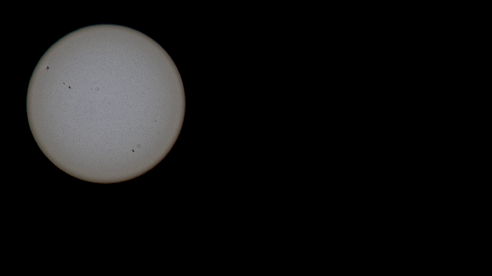

# Eclipse compositing — turn eclipse stills into a smooth video

Take hundreds of RAW stills of a solar eclipse (or a lunar eclipse, or a sun/moon
time-lapse) and produce one video where the disk moves on a controlled path, sits at
a constant size, has matched exposure, and shows real surface detail without
flickering.

Built and validated on a real **162-frame partial solar eclipse** shoot: Canon RAW
(CR3), 250/320/400 mm, f/5.6–f/16, 1/20–1/125 s, mixed portrait and landscape,
the Sun drifting out of frame for stretches, and a house getting in the way near the
end.

[](media/partial-eclipse-4k.mp4)

`media/partial-eclipse-4k.mp4` — 3840×2160, 30 fps, 25 s.

---

## Why this exists

Compositing the frames is the easy part. Every *measurement* you need to do it
breaks somewhere in an eclipse, and each break looks like a different bug later:

| Symptom | Actual cause |
|---|---|
| Sun jitters or wobbles | brightness centroid drifts into the moon as the crescent thins (121 px error at 8 % coverage) |
| Brightness pulses at maximum eclipse | per-frame brightness matching fights limb darkening |
| Gain explodes / frames blow out | photometric exposure solve divides by near-zero on a thin crescent (gains up to **2294×** measured) |
| Sun changes size between shots | zoom was changed mid-shoot; radius must be fitted per frame, not assumed |
| Grey, washed-out, flat disk | double gamma — `x**(1/2.2)` followed by sRGB encoding |
| Bright ring around the Sun | local contrast blurs across the limb, averaging in black sky |
| Rubberbanding motion | easing each keyframe independently drives velocity to zero at every shot |

Every one of those is documented with measurements in [`docs/traps.md`](docs/traps.md),
and each has a fix in this repo.

## Results on the reference shoot

| Metric | Before | After |
|---|---|---|
| Sky background | 58/255 grey | **0** |
| Disk brightness | 229/255, clipped | 132, none clipped |
| Limb edge | 174 (halo) | 65 (darker than interior, as physics requires) |
| Surface detail (HF std) | 0.34 | **1.10** (2.2× plain curve) |
| Exposure recovery error | up to 2294× | EXIF-physics model, true spread 9.5× |
| Disk centring error | 121 px at deep crescent | < 2 px at every phase |

Reference frame comparisons: [`media/compare_tone.png`](media/compare_tone.png)
(four tone variants side by side) and
[`media/compare_limb_zoom.png`](media/compare_limb_zoom.png) (1:1 limb zoom, where the
halo is visible).

## Use it as an OpenClaw skill

This repository **is** an OpenClaw skill — `SKILL.md` sits at the root, which is the
convention skill repositories use. Clone it anywhere and point OpenClaw at it:

```json5
// ~/.openclaw/openclaw.json
{
  skills: {
    load: {
      extraDirs: ["~/path/to/eclipse-compositing"]
    }
  }
}
```

Then confirm it is loaded:

```bash
openclaw skills list --agent <your-agent>
# ✓ ready  celestial-compositing   ...   openclaw-extra
```

Two things to know:

- **Agent allowlists are strict.** If your agent has an explicit `skills` list, the
  skill must be named in it or it stays invisible. An explicit list *replaces*
  inherited defaults rather than merging, so add it by name:

  ```json5
  { agents: { entries: { "my-agent": { skills: ["celestial-compositing"] } } } }
  ```

  An empty `skills: []` anywhere in the chain hides every skill — that is exactly how
  this one got silently excluded on first install.

- **Or drop it in a skills root instead.** You can also place the folder at
  `<workspace>/skills/celestial-compositing/` (or any subfolder up to 6 levels deep);
  discovery finds `SKILL.md` wherever it appears under a configured root.

The agent reads `SKILL.md` for the procedure and the trap list, then uses `scripts/`
directly. Paths in `SKILL.md` are relative to the skill folder (`{baseDir}`).

## Quick start

```bash
# 1. toolchain (no root needed)
uv venv .venv
uv pip install --python .venv/bin/python -r requirements.txt

# 2. put your stills in frames/
mkdir -p frames && cp /path/to/your/*.CR3 frames/

# 3. cut out the disks (2160 px tiles, disk at 648 px radius -> 4K, no upscaling)
python scripts/cutouts.py --dir frames --out out/cutouts --tile 2160

# 4. REVIEW before animating -- contact sheets and a short preview
python scripts/contact_sheet.py --dir out/cutouts --out out/cutouts/sheets

# 5. animate
python scripts/render.py --meta out/cutouts/meta.json --tiles out/cutouts \
        --out out/partial-eclipse-4k.mp4 --seconds 25
```

Stage 4 is not optional. A human catches per-frame problems in seconds that no
metric flags — wrong crops, frames where the disk left the sensor, a badly placed
frame. Expect to drop a handful.

## The five stages

```
1 detect   RAW -> disk centre + radius per frame        -> meta.json
2 measure  exposure from EXIF, limb darkening from data  -> gain per frame
3 cut      square, radius-normalised, tone-mapped tiles  -> tiles/*.png
4 review   contact sheets + preview video                -> human approval
5 animate  tiles on a synthetic path                     -> final.mp4
```

Each stage writes a file the next one reads, so any stage can be re-run alone.

## What is real, and what is generated

This matters, and it is stated up front for a reason.

- **Content is real.** Every frame is the actual processed pixels from that moment of
  the eclipse. The moon's advance is genuine — nothing is drawn, morphed or invented.
- **Motion is synthetic.** Where the disk sat inside each source frame only records
  where the camera was pointed. It jitters between shots and carries no information
  about the eclipse. Driving placement from it produces visible wobble, so the path
  is generated: one continuous monotone move, constant speed, soft ramps only at the
  two ends. No per-shot easing, so velocity never drops to zero mid-sequence.

For a *sun time-lapse* (not an eclipse) the opposite is true — the real path across
the frame is the content. See [`docs/recipes.md`](docs/recipes.md).

## Resolution rule

Match the display disk radius to the native source radius, or larger.

A 500 px source disk rendered at 324 px throws away detail. A 1080 tile inside a
4K frame gives the disk only ~25 % of frame width and looks soft.

```
tile ≈ native_radius / diskfrac
```

For a 4K output with the disk at ~34 % of frame width: `--tile 2160 --diskfrac 0.30`
puts the disk at 648 px. Composite tiles **1:1**, never resample the disk.

## Encoding

Flat bright disks on black are exactly where H.264 artefacts show. Use **CRF 12**
with `-preset slow`, not the default. Verify with PSNR against a source frame; expect
>60 dB. A 25 s 4K piece at this quality lands around 20 MB — that is not too big,
it is the point.

## Quality gates

Check these before delivering; each one exists because it failed at least once here.

```
sky p99        == 0        empty sky must be black, not grey
disk mean      tight       no flicker across the sequence
clipping       ~0 %        a clipped disk has no detail to recover
limb < inner   always      limb darkening preserved, no halo
border lit     == 0        nothing touches the canvas edge
disk radius    constant    within 1-2 px of target
downscale      <= 1.0      never upscale past native
```

## Repository layout

```
README.md
requirements.txt
config/
  exclusions.example.json    reviewed drop-list format
scripts/
  sunlib.py                  disk detection, limb-darkening fit, moon fit
  tonemap.py                 display mapping (the one transfer function)
  pipeline.py                RAW decode, exposure solve, EXIF listing
  cutouts.py                 radius-prior cutouts -> tiles + meta.json
  contact_sheet.py           review sheets
  render.py                  synthetic track -> ffmpeg
docs/
  traps.md                   measured evidence for every failure mode
  recipes.md                 lunar eclipse, sun time-lapse, moon time-lapse
media/                       reference output and comparison stills
```

`sunlib.py` and `tonemap.py` are the substance; the drivers show wiring.

## Adapting it

The pipeline is the same for other celestial subjects, but the traps do not transfer
uniformly. A lunar eclipse inverts the detection polarity (the disk is dark red — use
`R − B` chroma, not luminance) and its limb-darkening fit generally should not be
used. A sun time-lapse has no moon to fit, but its real path is content rather than
noise.

[`docs/recipes.md`](docs/recipes.md) covers each case and opens with the five facts
to establish before writing any code:

1. Is the disk brighter or darker than its surround?
2. Is the angular size constant, or does it drift?
3. What becomes unmeasurable at extreme phase, and when?
4. Is EXIF exposure trustworthy (manual) or compensated (auto)?
5. Is the real motion data or noise?

## Requirements

Python 3.11+, and `rawpy`, `numpy`, `opencv-python-headless`, `scipy`, `Pillow`,
`imageio-ffmpeg`. `exiftool` for metadata (optional but strongly recommended —
exposure comes from EXIF).

`imageio-ffmpeg` ships a **static ffmpeg 7.x with the full filter set**, so no system
ffmpeg is needed. Note that Remotion's bundled compositor ffmpeg is compiled with
`crop`/`overlay`/`eq`/`curves` **disabled** — it encodes, it cannot composite.

## Limitations

- **Resolution is capped by the sensor.** At deep crescent only a few hundred pixels
  of photosphere are lit; detail there is what the camera caught, not something
  post-processing can recover.
- **Saturated frames cannot be rescued.** Once the disk is clipped, brightening only
  adds noise. Exclude them rather than tone-mapping harder.
- **Thin crescents give uncertain geometry.** Moon-offset fits with IoU < 0.75 should
  be reported as uncertain rather than presented as precise.
- **Frames where the disk left the sensor** are solvable geometrically (radius from
  the focal group, centre from an arc fit) but usually contribute little. Review and
  drop them explicitly.

## License

MIT for the code. The media in `media/` is the reference output from my own shoot and
is included as an example; replace it with your own if you redistribute.
